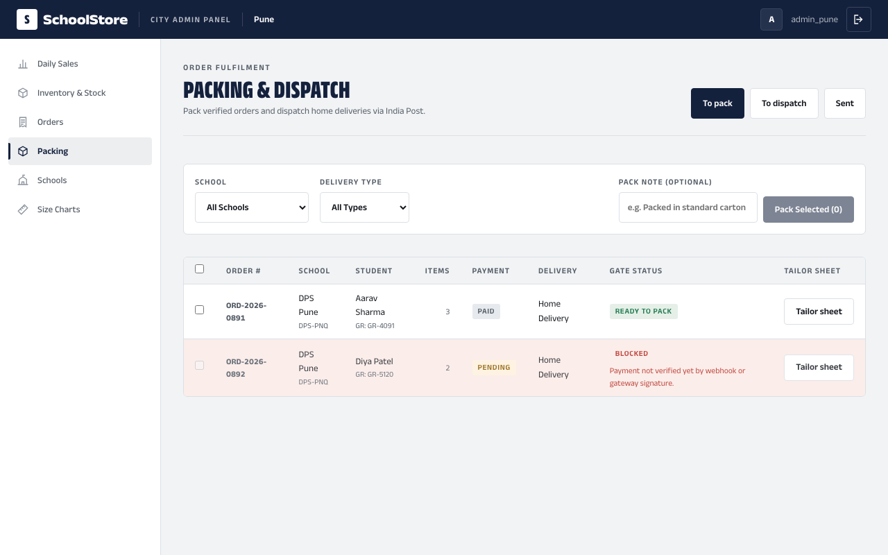
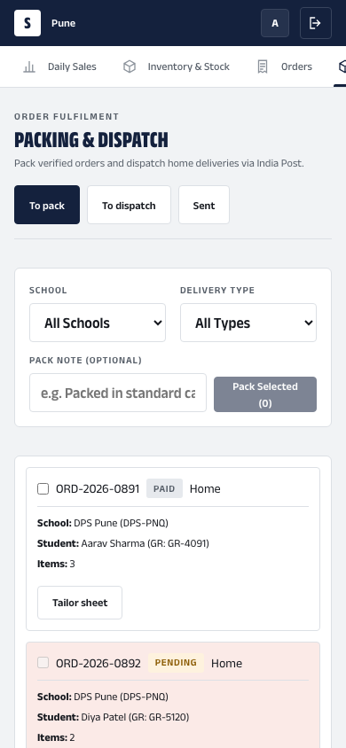
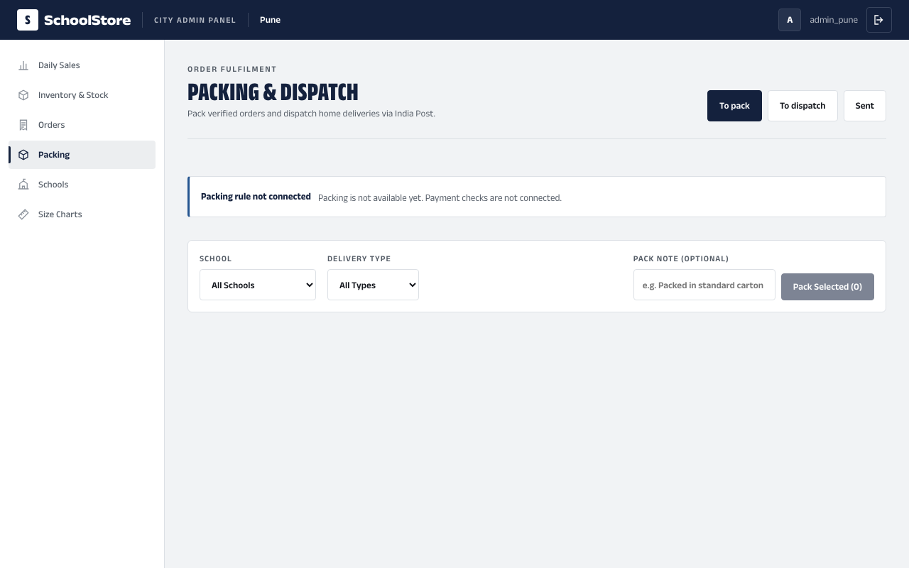
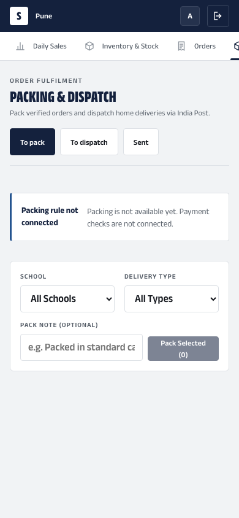
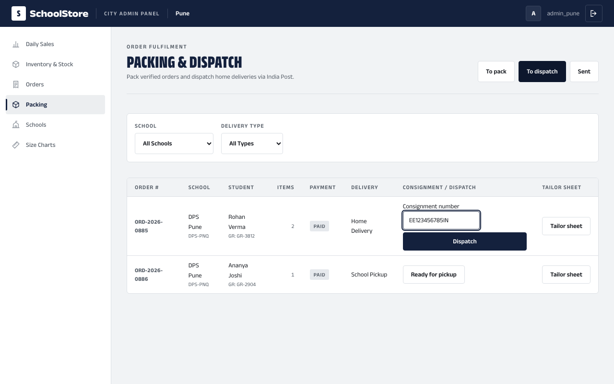
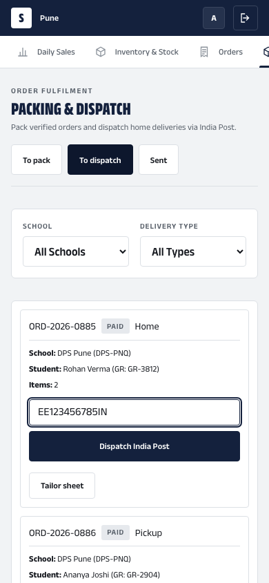
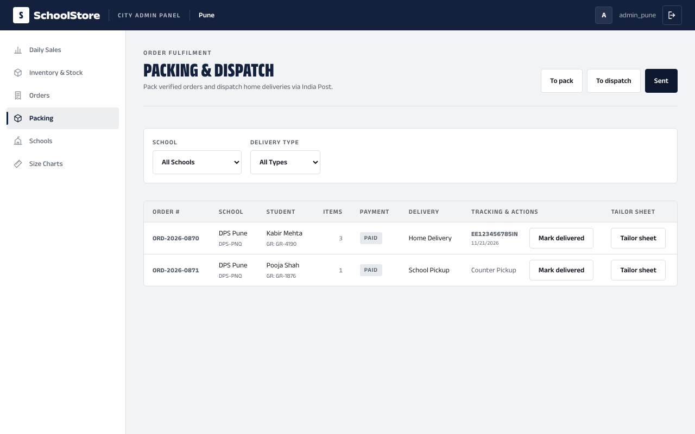
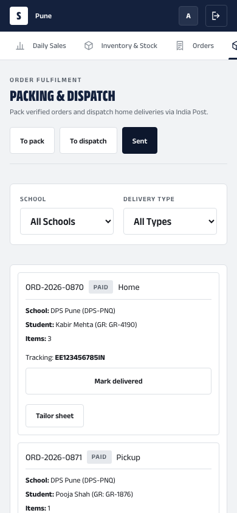

# Walkthrough: Day 3 Task A — Staff Packing and India Post Dispatch

## 1. Git Branch and Changes Summary

### Branch
```bash
$ git branch --show-current
day3-fulfilment
```

### Git Diff Stat against `main`
```text
backend/config/settings.py                         |   6 +
backend/orders/admin.py                            |  21 +-
backend/orders/apps.py                             |   3 +
backend/orders/fcm.py                              |  11 +-
backend/orders/fulfilment.py                       | 272 ++++++++
backend/orders/fulfilment_gate.py                  |  58 ++
backend/orders/fulfilment_views.py                 | 275 +++++++++
backend/orders/migrations/0016_shipment.py         |  33 +
backend/orders/models.py                           |  87 +++
backend/orders/status.py                           |   4 +-
backend/orders/tasks.py                            |   4 +-
backend/orders/test_fulfilment.py                  | 457 ++++++++++++++
backend/orders/urls.py                             |   5 +
backend/orders/views.py                            |   9 +
docs/walkthroughs/day3-a-staff-fulfilment.md       | 237 +++++++
docs/walkthroughs/screenshots/503-notice-390.png   | Bin 0 -> 39033 bytes
docs/walkthroughs/screenshots/503-notice-desktop.png | Bin 0 -> 53724 bytes
docs/walkthroughs/screenshots/sent-390.png         | Bin 0 -> 48617 bytes
docs/walkthroughs/screenshots/sent-desktop.png     | Bin 0 -> 70840 bytes
docs/walkthroughs/screenshots/to-dispatch-consignment-390.png | Bin 0 -> 48876 bytes
docs/walkthroughs/screenshots/to-dispatch-consignment-desktop.png | Bin 0 -> 72691 bytes
docs/walkthroughs/screenshots/to-pack-blocked-390.png | Bin 0 -> 51783 bytes
docs/walkthroughs/screenshots/to-pack-blocked-desktop.png | Bin 0 -> 78350 bytes
frontend/src/api.ts                                |  44 ++
frontend/src/components/admin/FulfilmentQueue.test.tsx | 206 +++++++
frontend/src/components/admin/FulfilmentQueue.tsx  | 683 +++++++++++++++++++++
frontend/src/components/admin/panel.css            | 129 ++++
frontend/src/pages/CityAdmin.tsx                   |  27 +-
frontend/vitest.config.ts                          |   2 +-
scripts/capture_fulfilment_screenshots.py          | 342 +++++++++++
```

---

## 2. Day 2 Contract Status

- **Status:** **Not merged, packing closed**.
- Day 2's payment verification and packing decision callable (`orders.payment_rules:packing_decision`) is not yet merged in the codebase.
- In `backend/orders/fulfilment_gate.py`, lazy import fallback is wired:
  ```python
  try:
      from orders.payment_rules import packing_decision
  except ImportError:
      return PackingDecision(
          False,
          "PACKING_RULE_NOT_WIRED",
          "Packing is not available yet. Payment checks are not connected.",
      )
  ```
- Any attempt to pack when Day 2's rule is not wired returns HTTP 503 `{"code": "PACKING_RULE_NOT_WIRED", "detail": "Packing is not available yet. Payment checks are not connected."}`, and the UI displays a clear notice with the action disabled.

### Development Fixture Setting: `FULFILMENT_PACKING_FIXTURE`
- **Setting name:** `FULFILMENT_PACKING_FIXTURE` in `backend/config/settings.py`.
- **Allowed values in dev:**
  - `"allow"`: forces gate decision to allowed (`allowed=True`).
  - Machine error codes (e.g. `"PAYMENT_NOT_VERIFIED"`, `"PAYMENT_FAILED"`, `"RESERVATION_RELEASED"`, `"REFUND_PENDING"`, `"ORDER_NOT_PACKABLE"`): forces gate decision to blocked with that code.
- **Safety check:** Enforced only when `settings.DEBUG` is `True`.
- **Django System Check (`orders.E001`):** A custom check `check_fulfilment_fixture_setting` registered in `backend/orders/fulfilment_gate.py` and loaded via `OrdersConfig.ready()` raises `orders.E001` if `FULFILMENT_PACKING_FIXTURE` is non-empty while `DEBUG` is `False`. Startup fails in production if the setting is present. It is never added to production environment files.

---

## 3. Database Migrations

### Makemigrations Check
```bash
$ python manage.py makemigrations --check --dry-run
No changes detected
```

### Orders Migrations Tree
```bash
$ python manage.py showmigrations orders
orders
 [X] 0001_initial
 [X] 0002_order_parent_order_idx_order_parent_created
 [X] 0003_order_checkout
 [X] 0004_order_fulfillment_type_order_payer_and_more
 [X] 0005_order_student_class_and_more
 [X] 0006_order_branch_order_idx_order_branch_created
 [X] 0007_order_payment_method
 [X] 0008_photoconsent
 [X] 0009_orderitem_chosen_size_orderitem_fit_height_cm_and_more
 [X] 0010_orderitem_fit_shoulder_cm_and_more
 [X] 0011_orderitem_fit_source
 [X] 0012_order_razorpay_id_index
 [X] 0013_devicetoken
 [X] 0014_orderitem_fit_model_version
 [X] 0015_orderitem_fit_feedback_and_more
 [ ] 0016_shipment
```

- **Parent of new migration:** `('orders', '0015_orderitem_fit_feedback_and_more')`.
- **New migration file:** `backend/orders/migrations/0016_shipment.py`.
- **Model:** `Shipment` with `carrier=INDIA_POST`, 13-char unique uppercase `consignment_number`, `booked_at`, `created_by`, and index `idx_shipment_consignment`.

---

## 4. Test Results and Build Verification

### Backend Tests
Ran with `USE_SQLITE=1` as documented in `00-ground-rules.md` (PostgreSQL requires local service credentials).

```text
$ USE_SQLITE=1 python manage.py test orders
Found 86 test(s).
Creating test database for alias 'default'...
System check identified no issues (0 silenced).
......................................................................................s
----------------------------------------------------------------------
Ran 86 tests in 37.908s

OK (skipped=1)
Destroying test database for alias 'default'...
```

Key test coverage in `backend/orders/test_fulfilment.py` (23 tests):
- S10 check digit pure function: known good numbers (check digits 0, 4, 5) and known bad/malformed numbers.
- System check `orders.E001`: triggers when `FULFILMENT_PACKING_FIXTURE` is set while `DEBUG=False`.
- Gate missing rule: returns `PACKING_RULE_NOT_WIRED` and pack endpoint returns 503 without changing orders.
- Fixture allowed: packs confirmed/processing order, writes PACKED event with `changed_by`, writes audit log, queues FCM push and summary refresh on commit.
- Each blocked reason: leaves order unchanged, reports reason code in response, writes no event.
- Row lock verification: verifies `transaction.get_connection().in_atomic_block` is True during gate execution.
- Bypass closure: unpaid `PLACED`/`PENDING` orders rejected by PATCH, bulk status, and pack. Generic status view rejects `PROCESSING`, `PACKED`, `DISPATCHED`, `DELIVERED`.
- Role scoping: City Admin only sees and acts on their city; cross-city orders skipped or 404; non-admin roles get 403 on all fulfilment endpoints; BOSS can act across all cities.
- Dispatch: enforces `HOME_DELIVERY` and `PACKED`, validates S10 check digit, rejects duplicates with 409, upper-cases numbers.
- Pickup: moves `SCHOOL_PICKUP` from `PACKED` to `DISPATCHED` with note "Ready at the school counter.", creates no shipment row.
- Delivered: moves to `DELIVERED`; regression test verifies `send_post_delivery_fit_prompts()` finds it without `FieldError` on `timestamp`.
- Queue performance: `assertNumQueries` remains flat for 1 and 50 orders (no N+1 query regression).

### Vitest Frontend Tests
```text
$ cd frontend && npx vitest run
 ✓ src/native/offline.test.ts (7 tests)
 ✓ src/measure/measureBody.test.ts (41 tests)
 ✓ src/native/navigation.test.ts (7 tests)
 ✓ src/measure/noUpload.test.ts (7 tests)
 ✓ src/native/touches.test.ts (8 tests)
 ✓ src/components/admin/FulfilmentQueue.test.tsx (7 tests)
 ✓ src/components/admin/retail/uniformDetect.test.ts (7 tests)
 ✓ src/components/admin/retail/mockupEngine.test.ts (10 tests)
 ✓ src/measure/overlay.test.ts (4 tests)
 ✓ worker/showcaseSizing.test.js (13 tests)
 ✓ src/components/orders/FitFeedbackPrompt.test.ts (6 tests)
 ✓ src/native/push.test.ts (3 tests)
 ✓ src/native/native.test.ts (5 tests)
 ✓ src/motion/SmoothScroll.test.ts (2 tests)
 ✓ src/store/flowStep.test.ts (4 tests)
 ✓ src/data/sizingEstimate.test.ts (10 tests)

 Test Files  16 passed (16)
      Tests  141 passed (141)
   Duration  1.07s
```

FulfilmentQueue Vitest test suite (`FulfilmentQueue.test.tsx`):
- `validateConsignmentFormat` helper: verifies valid S10 numbers, rejects bad check digits, handles malformed strings and lowercase characters.
- Loading state: renders skeleton rows with `<Skeleton />`.
- Blocked row: disabled checkbox and displays the block reason message.
- 503 notice: renders notice banner when Day 2 packing rule is not connected, disables pack action.

### Production Build
```text
$ cd frontend && npm run build
> school-store-web@1.0.0 build
> tsc -b && vite build

vite v5.4.21 building for production...
✓ 1271 modules transformed.
✓ built in 2.54s
```

---

## 5. Screenshots

All screenshots captured at 1280x800 (Desktop) and 390x844 (Mobile) using Playwright.

### Scenario 1: To Pack with One Blocked Row
*Desktop (1280x800):*


*Mobile (390x844):*


### Scenario 2: 503 Notice (Day 2 Packing Rule Not Connected)
*Desktop (1280x800):*


*Mobile (390x844):*


### Scenario 3: To Dispatch with Consignment Number Entered
*Desktop (1280x800):*


*Mobile (390x844):*


### Scenario 4: Sent / Dispatched Orders
*Desktop (1280x800):*


*Mobile (390x844):*


---

## 6. Day 2 File Isolation and Overlap Report

### Day 2-Owned Files NOT Touched
We verified zero edits to the following Day 2-owned modules and functions:
- `backend/orders/status.py`: `record_payment` and `_restock` were not modified.
- `backend/orders/tasks.py`: `release_expired_reservation` was not modified.
- `backend/orders/views.py`: `payment` and `verify_payment` endpoints were not modified.
- `backend/orders/webhooks.py`: `razorpay_webhook` was not modified.
- `backend/orders/serializers.py`: `OrderCreateSerializer.create` (checkout) was not touched. Parent tracking fields left untouched (reserved for Task B).
- Day 2 migrations: no existing migrations were modified.

### Files Touched from the Overlap Table

| File | Lines Changed | Description |
|---|---|---|
| `backend/orders/status.py` | 27-28 | Removed `PLACED` and `PENDING` transitions to `PACKED` in `ALLOWED_TRANSITIONS`. |
| `backend/orders/tasks.py` | 125-126 | Fixed `send_post_delivery_fit_prompts` query to filter `timestamp__gte` and `timestamp__lte` (was nonexistent `created_at`). |
| `backend/orders/views.py` | 156-161, 170-171 | Added `_FULFILMENT_ONLY` status set; `_change_status` refuses generic transitions with 400 `"Use the fulfilment actions for this step."`. |
| `backend/orders/models.py` | 457-538 | Added `validate_s10_check_digit` pure function and `Shipment` model. |
| `backend/orders/fcm.py` | 53-62 | Added India Post consignment tracking text to `DISPATCHED` home delivery notification body. |
| `backend/orders/urls.py` | 11, 18-19, 33 | Registered `FulfilmentViewSet` router at `/api/fulfilment/`. |
| `backend/orders/admin.py` | 4, 19-33, 44, 182-192 | Added `ShipmentInline` to `OrderAdmin` and registered `ShipmentAdmin`. |
| `backend/config/settings.py` | 453-455 | Added `FULFILMENT_PACKING_FIXTURE` configuration. |
| `backend/orders/apps.py` | 8-10 | Added `ready()` method to import `fulfilment_gate` and discover the system check. |
| `frontend/src/api.ts` | 489-493, 497-536 | Added `cityAdmin` fulfilment methods (`fulfilmentQueue`, `pack`, `dispatch`, `readyForPickup`, `markDelivered`) and TypeScript types. |
| `frontend/src/pages/CityAdmin.tsx` | 23, 38, 836-837, 874, 915-917, 969-977 | Wired "Packing" tab with icon `Package`, routed to `FulfilmentQueue`, restricted `BulkStatusUpdateModal` to Cancelled only, removed advancement past Confirmed in `OrderDetailModal` and linked to Packing. |
| `frontend/src/components/admin/panel.css` | 933-1061 | Added styles for `.fulfilment-queue`, desktop table, mobile responsive cards (<640px), and 44px tap targets. |
