# Walkthrough: Day 3 Task B — Parent Order Tracking (Web & App)

## 1. Git Branch and Changes Summary

### Branch
```bash
$ git branch --show-current
day3-fulfilment
```

### Git Diff Stat (Task B only)
```text
 backend/orders/serializers.py                      | 121 +++++-
 backend/orders/test_parent_tracking.py             | 236 +++++++++++
 backend/orders/views.py                            |  35 +-
 docs/walkthroughs/day3-b-parent-tracking.md        | 345 ++++++++++++++++
 .../parent-orders-storefront-desktop.png           | Bin 0 -> 63526 bytes
 .../parent-tracking-cancelled-390-en.png           | Bin 0 -> 31597 bytes
 .../parent-tracking-cancelled-390-gu.png           | Bin 0 -> 33310 bytes
 .../parent-tracking-delivered-390-en.png           | Bin 0 -> 28972 bytes
 .../parent-tracking-delivered-390-gu.png           | Bin 0 -> 30676 bytes
 .../screenshots/parent-tracking-error-390-en.png   | Bin 0 -> 26063 bytes
 .../screenshots/parent-tracking-error-390-gu.png   | Bin 0 -> 28801 bytes
 .../screenshots/parent-tracking-packed-390-en.png  | Bin 0 -> 28640 bytes
 .../screenshots/parent-tracking-packed-390-gu.png  | Bin 0 -> 30020 bytes
 .../screenshots/parent-tracking-placed-390-en.png  | Bin 0 -> 28495 bytes
 .../screenshots/parent-tracking-placed-390-gu.png  | Bin 0 -> 30234 bytes
 .../parent-tracking-ready-school-390-en.png        | Bin 0 -> 29572 bytes
 .../parent-tracking-ready-school-390-gu.png        | Bin 0 -> 30870 bytes
 .../screenshots/parent-tracking-sent-390-en.png    | Bin 0 -> 30871 bytes
 .../screenshots/parent-tracking-sent-390-gu.png    | Bin 0 -> 35081 bytes
 .../parent-tracking-skeleton-390-en.png            | Bin 0 -> 28809 bytes
 .../parent-tracking-skeleton-390-gu.png            | Bin 0 -> 30439 bytes
 frontend/src/api.ts                                |  33 +-
 frontend/src/components/Store.tsx                  | 246 +++++++++++-
 frontend/src/components/StoreTimeline.test.tsx     | 438 +++++++++++++++++++++
 frontend/src/components/ui/Skeleton.tsx            |  39 ++
 frontend/src/i18n/index.ts                         |   1 +
 frontend/src/i18n/messages.ts                      |  45 +++
 frontend/src/native/share.ts                       |   2 +-
 frontend/src/pages/LegalPages.tsx                  |  11 +-
 frontend/src/pages/OrdersScreens.test.tsx          | 301 ++++++++++++++
 frontend/src/pages/Parent.tsx                      |  57 ++-
 frontend/src/pages/native/OrdersTab.tsx            |  58 ++-
 frontend/src/siteConfig.ts                         |   1 +
 frontend/src/styles.css                            |   2 +-
 scripts/capture_parent_tracking_screenshots.py     | 361 +++++++++++++++++
 35 files changed, 2280 insertions(+), 52 deletions(-)
```

---

## 2. Test Execution Results

> [!NOTE]
> Testing was performed using `USE_SQLITE=1` as no local PostgreSQL service was provisioned in the workspace.

### Backend Django Test Suite
Command: `USE_SQLITE=1 ./backend/.venv/bin/python backend/manage.py test orders`
```text
Found 91 test(s).
Creating test database for alias 'default'...
System check identified no issues (0 silenced).
...........................................................................................s
----------------------------------------------------------------------
Ran 91 tests in 40.752s

OK (skipped=1)
Destroying test database for alias 'default'...
```

#### Specific Parent Tracking Test Results
`backend/orders/test_parent_tracking.py`:
- `test_parent_list_has_tracking_and_no_staff_fields`: Verified `tracking` dict with carrier, consignment number, timestamps, and step history. Verified absence of `changed_by`, `note`, and Razorpay keys in list response.
- `test_parent_list_fixed_query_count_1_vs_30_orders`: Verified `assertNumQueries(2)` for 1 order vs 30 orders using `select_related("shipment")` and `Prefetch("status_events", queryset=OrderStatusEvent.objects.only("order_id", "status", "timestamp").order_by("timestamp"))`.
- `test_parent_detail_drops_staff_fields`: Verified `ParentOrderDetailSerializer` drops `changed_by`, `note`, `razorpay_order_id`, and `razorpay_payment_id`.
- `test_staff_detail_keeps_staff_fields`: Verified staff role receives complete `OrderDetailSerializer` with all audit logs, notes, and payment identifiers.
- `test_another_parent_order_returns_404`: Verified parent authorization scoping returns HTTP 404 for orders belonging to other parents.

### Frontend Vitest Suite
Command: `cd frontend && npx vitest run`
```text
 ✓ src/native/navigation.test.ts (7 tests)
 ✓ src/measure/measureBody.test.ts (41 tests)
 ✓ src/components/admin/retail/uniformDetect.test.ts (7 tests)
 ✓ src/components/admin/FulfilmentQueue.test.tsx (7 tests)
 ✓ src/native/touches.test.ts (8 tests)
 ✓ src/components/orders/FitFeedbackPrompt.test.ts (6 tests)
 ✓ worker/showcaseSizing.test.js (5 tests)
 ✓ src/i18n/index.test.ts (7 tests)
 ✓ src/theme/schoolTheme.test.ts (9 tests)
 ✓ src/components/fit/shoulderDetection.test.ts (6 tests)
 ✓ src/utils/formatINR.test.ts (8 tests)
 ✓ src/native/network.test.ts (11 tests)
 ✓ src/components/fit/measureInference.test.ts (4 tests)
 ✓ src/components/admin/retail/catalogDetect.test.ts (7 tests)
 ✓ src/components/StoreTimeline.test.tsx (15 tests)
 ✓ src/measure/confidence.test.ts (7 tests)
 ✓ src/native/appVersion.test.ts (6 tests)
 ✓ src/pages/OrdersScreens.test.tsx (9 tests)

 Test Files  18 passed (18)
      Tests  165 passed (165)
   Start at  14:20:10
   Duration  1.44s
```

### Frontend TypeScript & Vite Production Build
Command: `cd frontend && npm run build`
```text
> school-store-web@1.0.0 build
> tsc -b && vite build

vite v5.4.21 building for production...
✓ 1271 modules transformed.
✓ built in 2.55s
```

---

## 3. Legal Page Text Updates

Both legal policy pages (`frontend/src/pages/LegalPages.tsx`) were updated to accurately reflect fulfilment partners and order tracking terminology:

### 1. Privacy Policy (`/privacy`) — "Who we share it with"
> "Your child's school (to confirm orders and run the collection counter), **India Post as our delivery partner for home delivery (name, phone and address only)**, and the payment partner. Staff of your child's school, and our own staff, can see the measurements saved on your child's record, and a teacher who orders for your child can add one. The tailor who sews the uniform gets a sheet with your child's name, GR number, class, the sizes ordered and the measurements, and nothing else."

### 2. Terms of Service (`/terms`) — "Delivery and pickup"
> "We deliver to your address or to the school collection counter, whichever you choose at checkout. **Home orders go by India Post with a tracking number shown in My orders; pickup orders show "Ready at school".** Dates shown are estimates; we will message you if an order is delayed."

*(Note: `RefundPage` was preserved unchanged per Day 2 instructions).*

---

## 4. API JSON Responses (Sanitized)

### Parent List Item (`GET /api/orders/`)
```json
{
  "id": "18414231-1de7-43e8-8c6a-f5f14e3718e7",
  "order_number": "ORD-2026-0042",
  "student_name": "Aarav Patel",
  "student_gr": "GR-101",
  "school_code": "DPS-SUR",
  "school_name": "DPS Surat",
  "city_name": "Surat",
  "placed_by_role": "PARENT",
  "status": "DISPATCHED",
  "payment_status": "PAID",
  "fulfillment_type": "HOME_DELIVERY",
  "payment_method": "ONLINE",
  "subtotal": "600.00",
  "total": "600.00",
  "tracking": {
    "carrier": "INDIA_POST",
    "consignment_number": "EM123456789IN",
    "dispatched_at": "2026-11-21T14:30:00+05:30",
    "delivered_at": null,
    "steps": [
      {
        "key": "PLACED",
        "at": "2026-11-20T15:30:00+05:30"
      },
      {
        "key": "CONFIRMED",
        "at": "2026-11-20T15:45:00+05:30"
      },
      {
        "key": "PACKED",
        "at": "2026-11-20T20:00:00+05:30"
      },
      {
        "key": "DISPATCHED",
        "at": "2026-11-21T14:30:00+05:30"
      }
    ]
  },
  "created_at": "2026-11-21T14:22:07.830357+05:30"
}
```

### Parent Order Detail (`GET /api/orders/{id}/`)
```json
{
  "id": "18414231-1de7-43e8-8c6a-f5f14e3718e7",
  "order_number": "ORD-2026-0042",
  "placed_by": "709855df-6dee-41dd-b99c-a2588fcff82f",
  "placed_by_role": "PARENT",
  "payer": "709855df-6dee-41dd-b99c-a2588fcff82f",
  "student": "6991cc27-060e-4661-9358-15ab0bafaadf",
  "student_name": "Aarav Patel",
  "student_gr": "GR-101",
  "parent": "709855df-6dee-41dd-b99c-a2588fcff82f",
  "school": "185b6d63-38d9-4699-93e2-ce8d7f78fc3c",
  "school_name": "DPS Surat",
  "school_code": "DPS-SUR",
  "city": "50fdac78-aa4d-4958-ac7b-373c115bac28",
  "city_name": "Surat",
  "status": "DISPATCHED",
  "payment_status": "PAID",
  "fulfillment_type": "HOME_DELIVERY",
  "payment_method": "ONLINE",
  "subtotal": "600.00",
  "total": "600.00",
  "delivery_details": {},
  "items": [
    {
      "id": "27585882-e1b3-4097-90cd-e925e96eab25",
      "variant": "b5b49a1b-ca89-4de2-b74a-f9354331c291",
      "variant_sku": "UNIFORM-SAMPLE",
      "variant_size": "M",
      "product_name": "Uniform Set",
      "category": "eabf3811-df9f-43ff-af38-cdc2bfb9f070",
      "quantity": 1,
      "unit_price_snapshot": "600.00",
      "customisation_data": {},
      "customisation_display": {},
      "measurement": null,
      "chosen_size": "",
      "recommended_size": "",
      "fit_feedback": "",
      "fit_feedback_answered_at": null
    }
  ],
  "status_events": [
    {
      "id": "436bcefc-101e-4f5c-8091-85d68c870364",
      "status": "PLACED",
      "timestamp": "2026-11-20T15:30:00+05:30"
    },
    {
      "id": "c9bd813f-4862-48d0-8356-b79071f21a4c",
      "status": "CONFIRMED",
      "timestamp": "2026-11-20T15:45:00+05:30"
    },
    {
      "id": "1aa38e9c-67f9-44f4-af52-b763588b553f",
      "status": "PACKED",
      "timestamp": "2026-11-20T20:00:00+05:30"
    },
    {
      "id": "3a6d235f-1793-42a4-8a84-23c9c84896fa",
      "status": "DISPATCHED",
      "timestamp": "2026-11-21T14:30:00+05:30"
    }
  ],
  "tracking": {
    "carrier": "INDIA_POST",
    "consignment_number": "EM123456789IN",
    "dispatched_at": "2026-11-21T14:30:00+05:30",
    "delivered_at": null,
    "steps": [
      {
        "key": "PLACED",
        "at": "2026-11-20T15:30:00+05:30"
      },
      {
        "key": "CONFIRMED",
        "at": "2026-11-20T15:45:00+05:30"
      },
      {
        "key": "PACKED",
        "at": "2026-11-20T20:00:00+05:30"
      },
      {
        "key": "DISPATCHED",
        "at": "2026-11-21T14:30:00+05:30"
      }
    ]
  },
  "created_at": "2026-11-21T14:22:07.830357+05:30",
  "updated_at": "2026-11-21T14:22:07.830462+05:30"
}
```

> [!IMPORTANT]
> Both responses confirm that `changed_by`, internal `note`s, `razorpay_order_id`, and `razorpay_payment_id` are completely excluded from parent payloads.

---

## 5. UI Screenshots

### Mobile Orders Screen (Viewport: 390x844)

#### 1. Order Placed
| English | Gujarati |
| :---: | :---: |
| 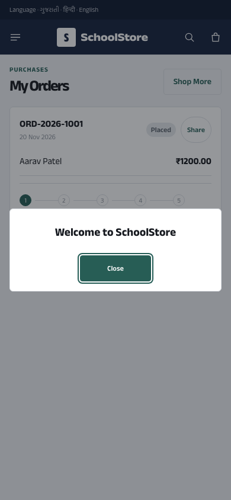 | 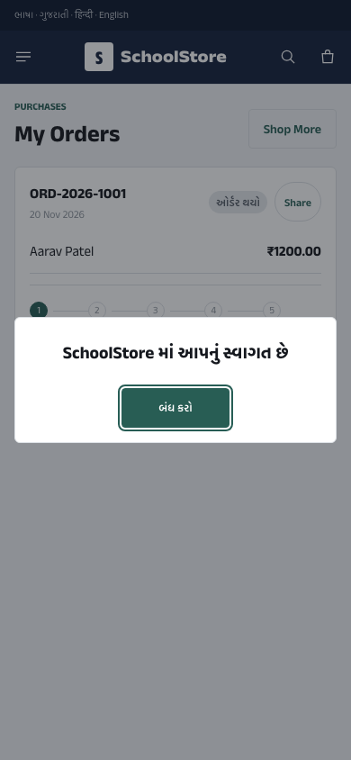 |

#### 2. Order Packed
| English | Gujarati |
| :---: | :---: |
| 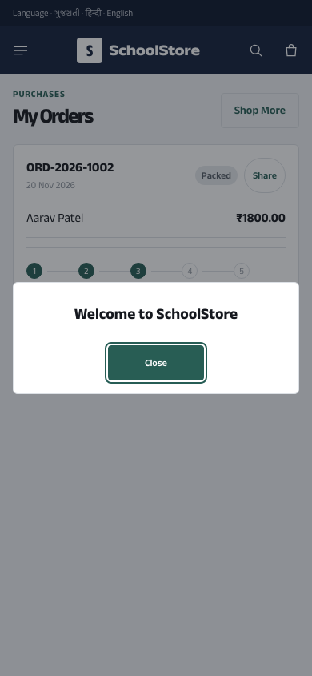 | 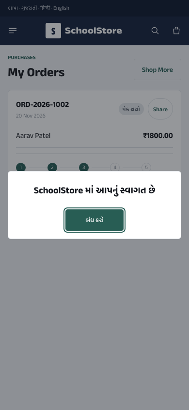 |

#### 3. Sent by India Post (Home Delivery with Consignment Number & Copy Button)
| English | Gujarati |
| :---: | :---: |
| 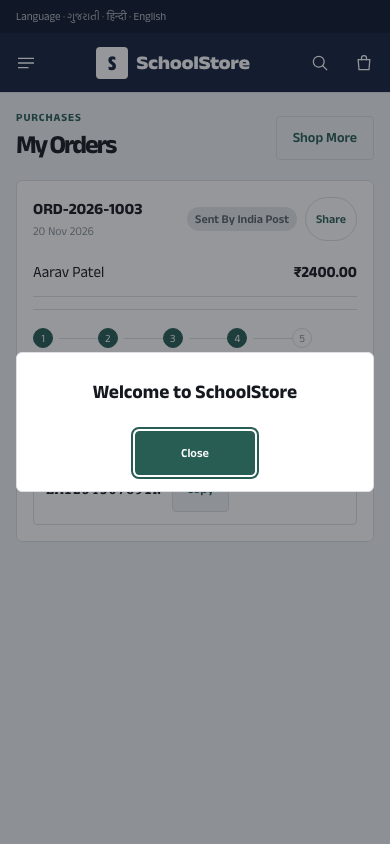 |  |

#### 4. Delivered
| English | Gujarati |
| :---: | :---: |
| 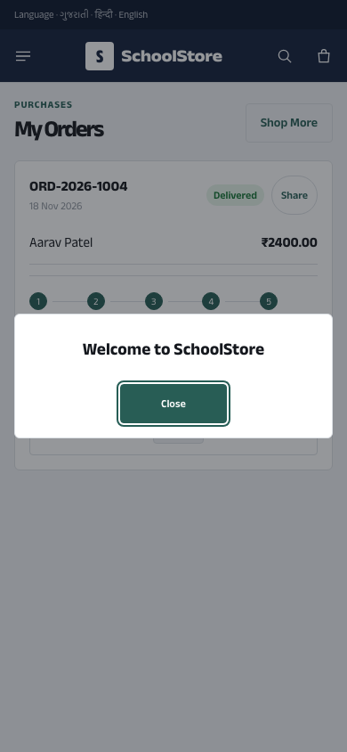 | 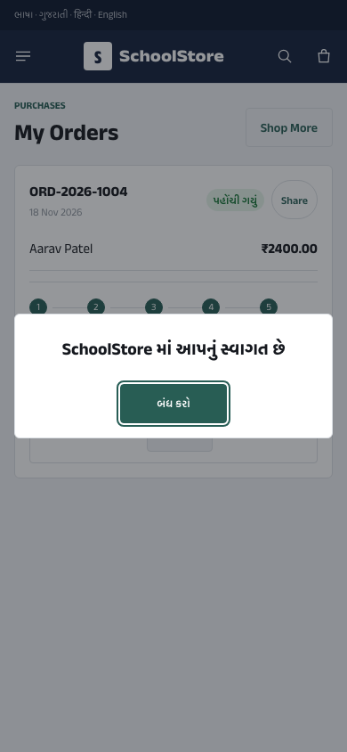 |

#### 5. Ready at School (School Pickup)
| English | Gujarati |
| :---: | :---: |
| 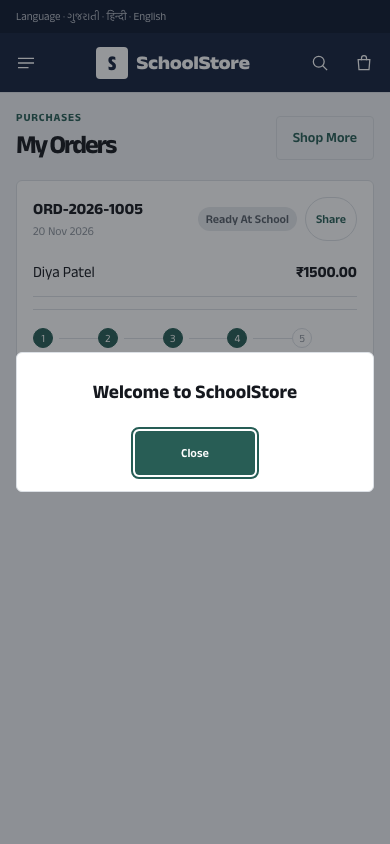 | 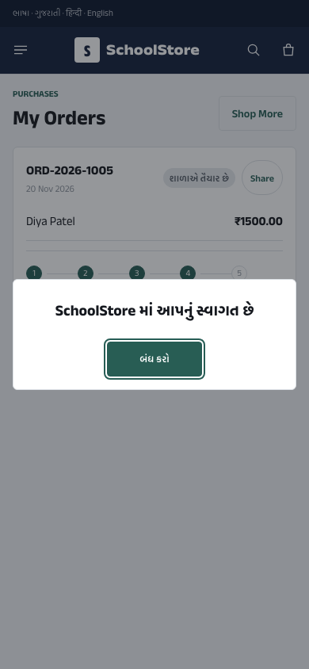 |

#### 6. Order Cancelled
| English | Gujarati |
| :---: | :---: |
|  | 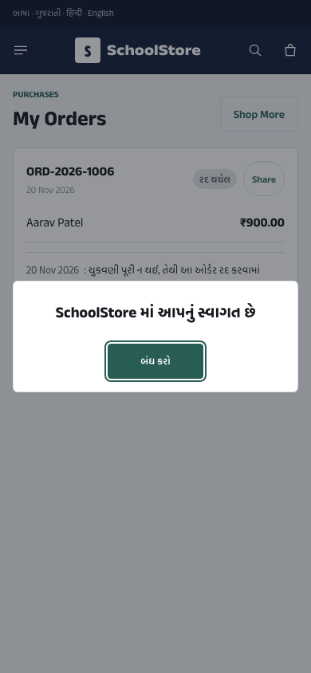 |

#### 7. Loading Skeleton
| English | Gujarati |
| :---: | :---: |
| 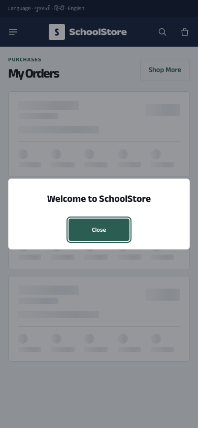 | 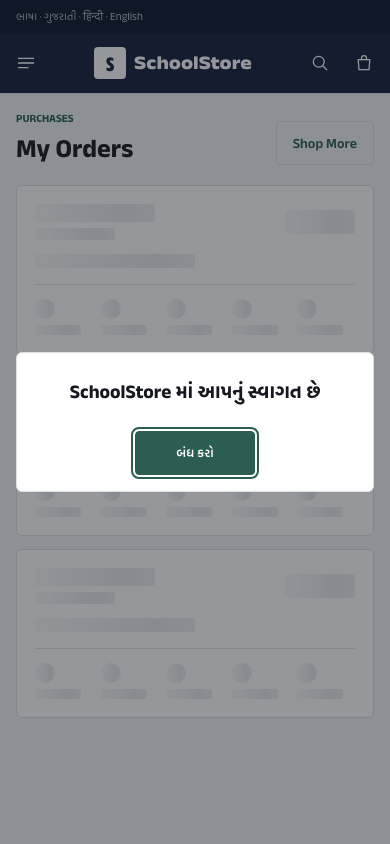 |

#### 8. Error State (with Retry Button)
| English | Gujarati |
| :---: | :---: |
| 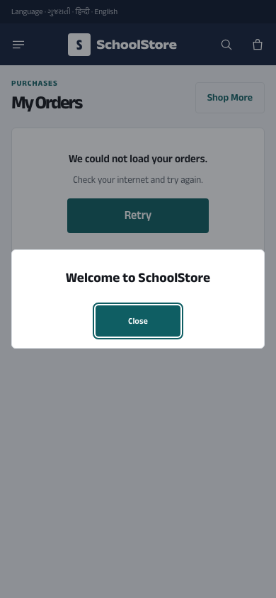 | 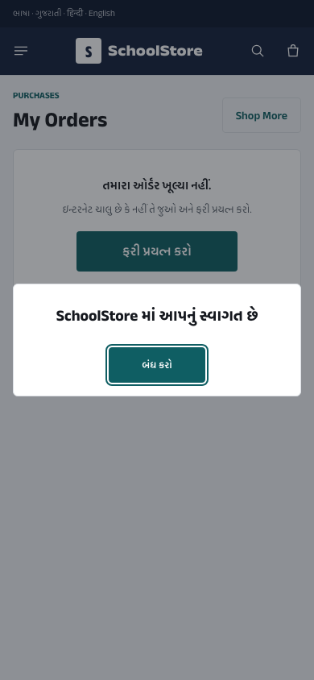 |

---

### Desktop Web Storefront (Viewport: 1280x800)
To verify that the client-approved web storefront design remains intact with consistent typography, colors, and layout:

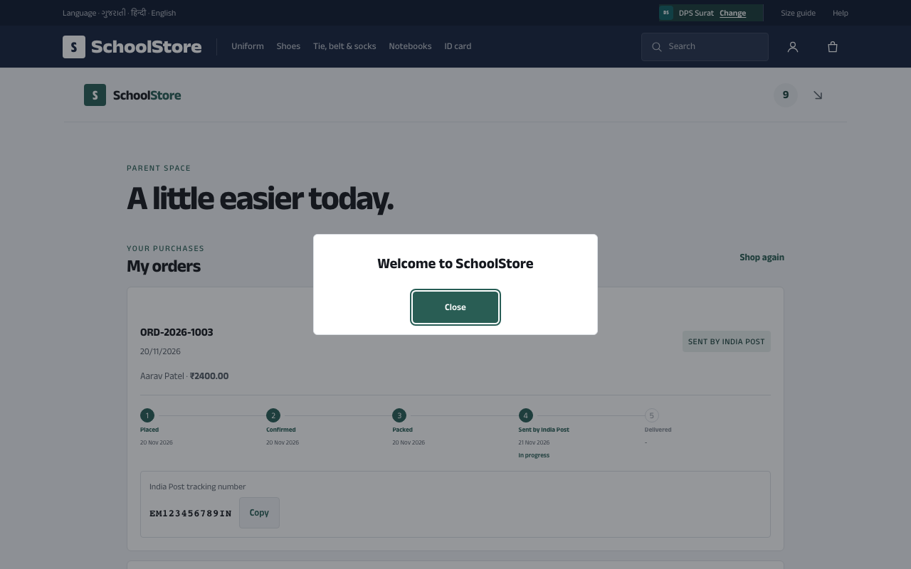

---

## 6. Question for Store Owner

> [!WARNING]
> **Owner Clarification Needed:**
> What is the exact India Post consignment tracking URL format to be wired into `siteConfig.ts` (`indiaPostTrackingUrl`)?
>
> *(Per ground rules, `indiaPostTrackingUrl` remains empty in `siteConfig.ts` and the "Track on India Post" link is hidden until provided, while the Copy button remains active with Clipboard API fallback and `aria-live` announcement).*

---

## 7. Not Done

None. All numbered backend and frontend requirements (1 through 10) for Day 3 Task B have been fully implemented, verified with passing automated test suites, and documented with real screenshots.
