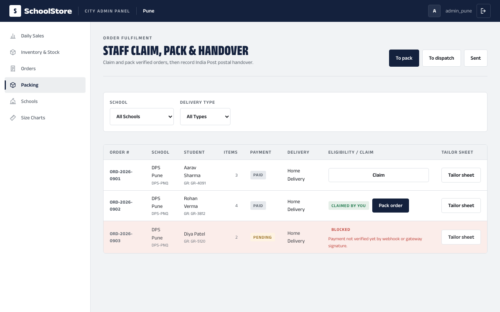
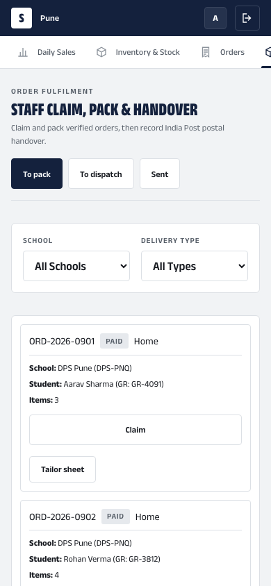
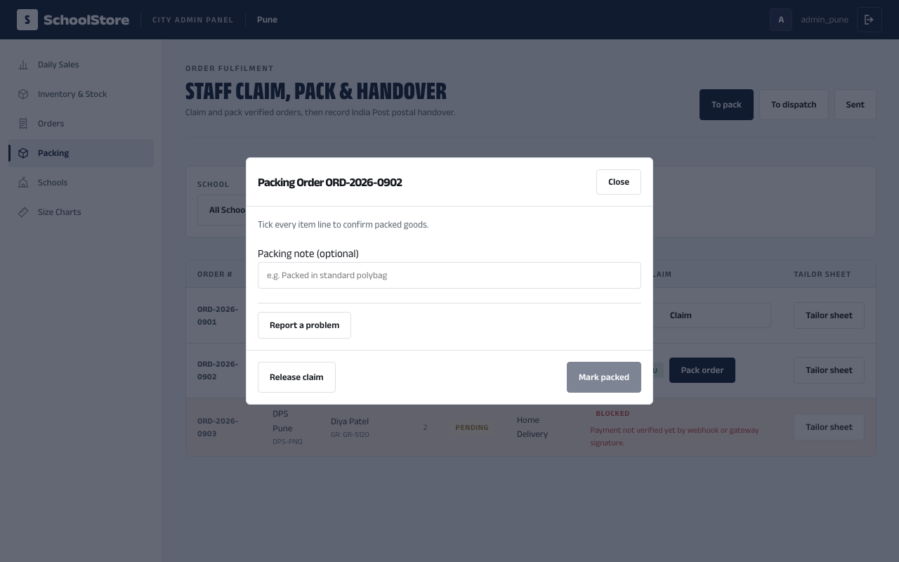
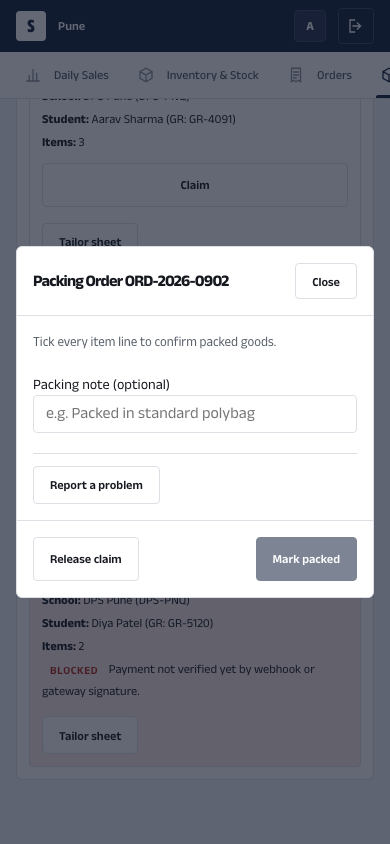
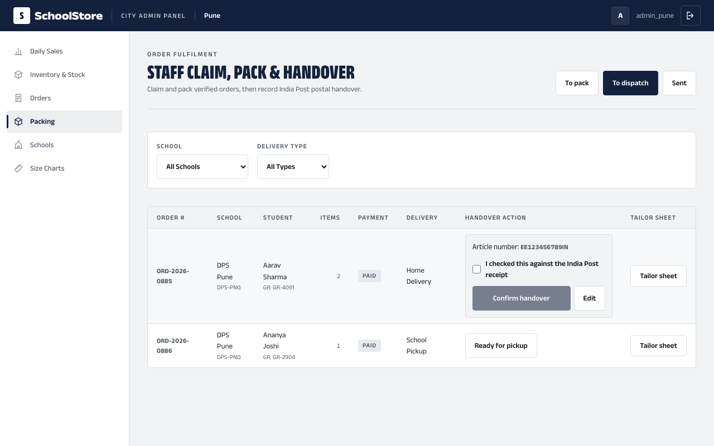
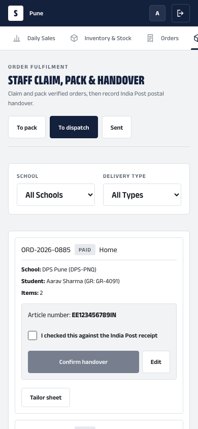
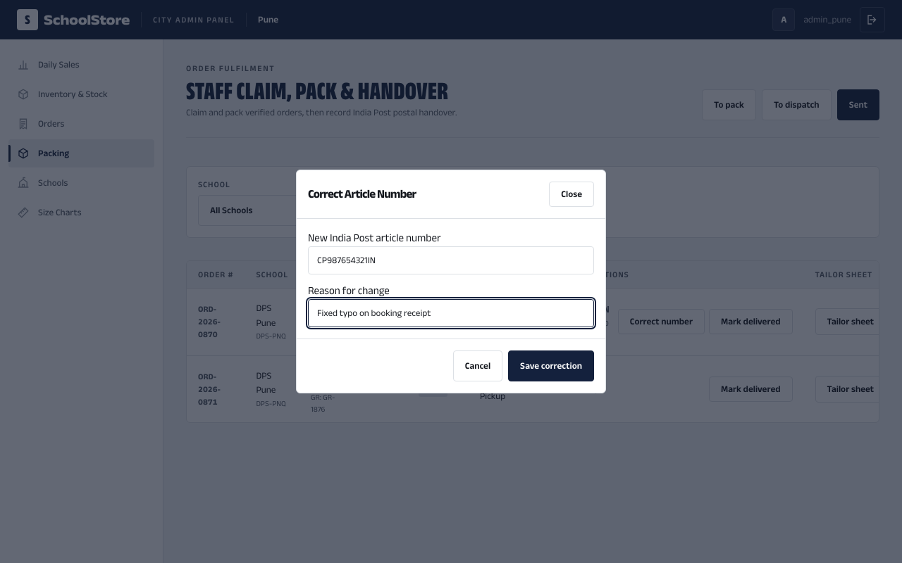
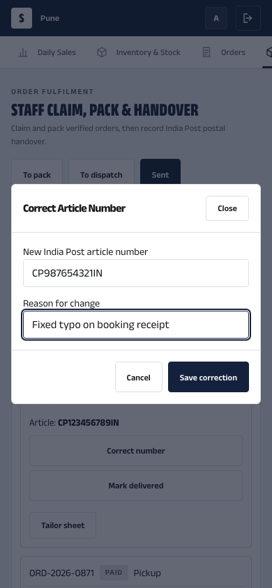
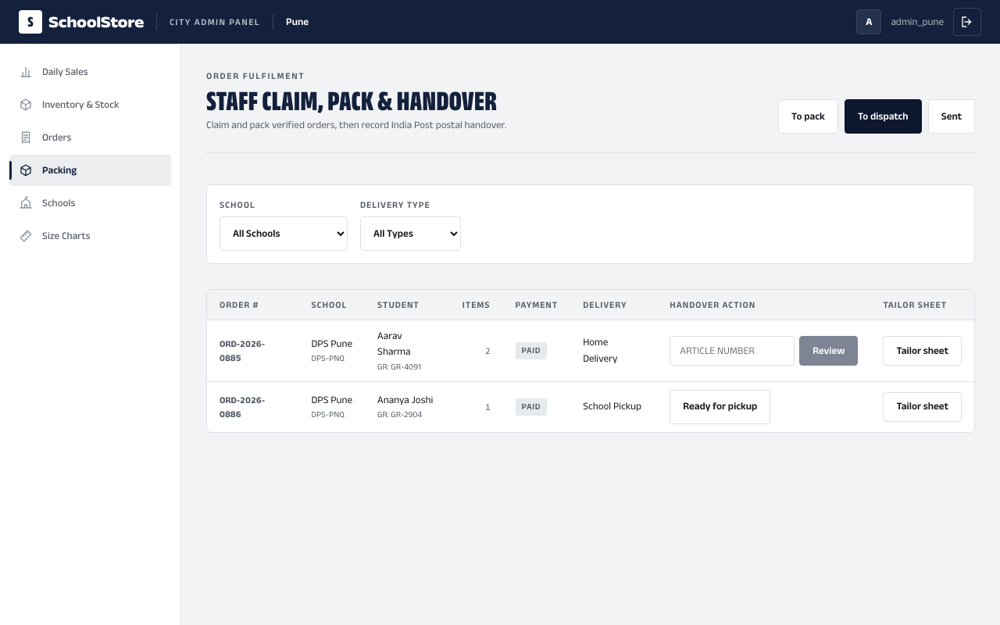
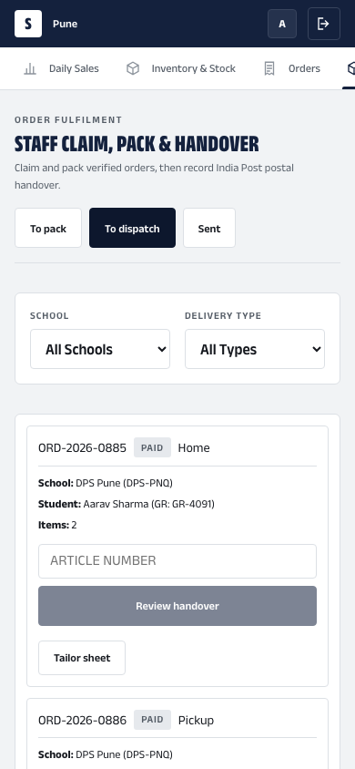

# Walkthrough: Day 3 Task C — Staff Claim, Pack, and Postal Handover

## 1. Git Branch and Changes Summary

### Branch
```bash
$ git branch --show-current
day3-fulfilment
```

### Git Diff Stat against Task B (`9d4b15f`)
```text
 backend/common/management/commands/seed_perf_orders.py  |    4 +-
 backend/orders/admin.py                                 |   16 +-
 backend/orders/fulfilment.py                            |  341 +++++++++++++++------
 backend/orders/fulfilment_views.py                      |  329 +++++++++++++-------
 backend/orders/migrations/0016_shipment.py              |   44 ++-
 backend/orders/models.py                                |   92 +++---
 backend/orders/test_fulfilment.py                       |  638 ++++++++++++++++++++++++++++++++++++---
 frontend/src/api.ts                                     |   51 +++-
 frontend/src/components/admin/FulfilmentQueue.test.tsx  |  113 ++++---
 frontend/src/components/admin/FulfilmentQueue.tsx       |  452 ++++++++++++++++++++-------
 frontend/src/components/admin/panel.css                 |  120 ++++++++
 frontend/src/native/native.test.ts                      |   15 +
 frontend/src/native/nativePlatform.ts                   |    9 +
 frontend/src/pages/OrdersScreens.test.tsx               |   28 +-
 frontend/src/pages/native/OrdersTab.tsx                  |    7 +-
 15 files changed, 1782 insertions(+), 477 deletions(-)
```

---

## 2. Migration Details

- **Migration file:** `backend/orders/migrations/0016_shipment.py`
- **Parent migration:** `0015_orderitem_fit_feedback_and_more.py`
- **Single Day 3 Migration:** All Task A legacy S10 / check digit code was removed completely. Migration `0016_shipment` is the single consolidated Day 3 migration creating:
  - `OrderPacking` (One-to-one with `Order`, related name `packing`, fields `claimed_by`, `claimed_at`, `packed_by`, `packed_at`, `issue_note`, `issue_reported_by`, `issue_reported_at`).
  - `Shipment` (One-to-one with `Order`, related name `shipment`, fields `consignment_number` max 40, `article_key` unique max 40, `booked_at`, `created_by`, `carrier` India Post).
  - `ShipmentCorrection` (Foreign key to `Shipment`, related name `corrections`, fields `previous_number`, `new_number`, `reason`, `changed_by`, `changed_at`).

### `makemigrations --check --dry-run` Output
```bash
$ .venv/bin/python manage.py makemigrations --check --dry-run
No changes detected
```

### `showmigrations orders` Output
```bash
$ .venv/bin/python manage.py showmigrations orders
orders
 [X] 0001_initial
 [X] 0002_order_parent_order_idx_order_parent_created
 [X] 0003_order_checkout
 [X] 0004_order_fulfillment_type_order_payer_and_more
 [X] 0005_order_student_class_and_more
 [X] 0006_order_branch_order_idx_order_branch_created
 [X] 0007_order_payment_method
 [X] 0008_photoconsent
 [X] 0009_orderitem_chosen_size_orderitem_fit_height_cm_and_more
 [X] 0010_orderitem_fit_shoulder_cm_and_more
 [X] 0011_orderitem_fit_source
 [X] 0012_order_razorpay_id_index
 [X] 0013_devicetoken
 [X] 0014_orderitem_fit_model_version
 [X] 0015_orderitem_fit_feedback_and_more
 [X] 0016_shipment
```

---

## 3. Test Suite Results

### Backend SQLite Suite
```bash
$ USE_SQLITE=1 .venv/bin/python manage.py test
Ran 364 tests in 29.560s
OK (skipped=22)
```
- 22 skipped tests comprise the PostgreSQL-specific concurrency tests across apps (including 4 concurrency tests in `orders.test_fulfilment.FulfilmentConcurrencyTests`).

### Backend PostgreSQL Suite (Port 54329)
```bash
$ USE_POSTGRES_FOR_TESTS=1 POSTGRES_HOST=127.0.0.1 POSTGRES_PORT=54329 POSTGRES_USER=postgres POSTGRES_DB=school_store .venv/bin/python manage.py test
Ran 364 tests in 141.456s
OK
```
- All 364 tests ran and passed on PostgreSQL.
- All 4 multi-threaded database concurrency tests ran and passed:
  1. `test_concurrency_simultaneous_claim`: Two threads claim the same order concurrently; exactly one succeeds with 200, the other receives 409 `ALREADY_CLAIMED`.
  2. `test_concurrency_repeated_pack`: Two threads submit pack requests simultaneously; exactly one transition occurs with one history event, and the repeat is safe (`changed=false`).
  3. `test_concurrency_repeated_dispatch`: Two threads submit identical postal dispatch requests simultaneously; exactly one `Shipment` is created and the duplicate returns `changed=false`.
  4. `test_concurrency_duplicate_article_number`: Two threads attempt to dispatch different orders using the same normalized article number; exactly one succeeds and the other receives 409 `ARTICLE_NUMBER_IN_USE` from database unique constraint catch.

### Frontend Quality Checks
```bash
$ cd frontend && npx vitest run
 Test Files  18 passed (18)
      Tests  165 passed (165)
   Start at  15:45:30
   Duration  1.55s

$ cd frontend && npx tsc -b
0 errors

$ cd frontend && npm run build
✓ built in 2.98s
dist/index.html 0.91 kB
dist/assets/index-*.js 481.07 kB
```

---

## 4. Demonstration Scenarios Matrix

| # | Scenario | Test Name | Result |
|---|---|---|---|
| 1 | Eligible prepaid order | `test_demonstrate_1_eligible_prepaid_order` | **PASS** |
| 2 | Eligible COD order | `test_demonstrate_2_eligible_cod_order` | **PASS** |
| 3 | Blocked online order (payment unverified) | `test_demonstrate_3_blocked_online_order` | **PASS** |
| 4 | Simultaneous claim (two staff members) | `test_demonstrate_4_simultaneous_claim` & `test_concurrency_simultaneous_claim` | **PASS** |
| 5 | Repeated pack and repeated dispatch request | `test_demonstrate_5_repeated_pack_and_repeated_dispatch` | **PASS** |
| 6 | Duplicate article number reuse rejection | `test_demonstrate_6_duplicate_article_number` & `test_concurrency_duplicate_article_number` | **PASS** |
| 7 | Out-of-scope staff account (forbidden/404) | `test_demonstrate_7_out_of_scope_staff_account` | **PASS** |
| 8 | School pickup (pickup flow, no postal data) | `test_demonstrate_8_school_pickup` | **PASS** |

### Additional Defect Regression Tests
- **Defect A1 (Validation of IDs):** `test_defect_a1_order_ids_serializer_validation` verifies that non-UUIDs, objects, empty lists, and lists > 200 return HTTP 400 with machine code `INVALID_ORDER_IDS`, never 500.
- **Defect A2 (Locked query outer joins):** `test_defect_a2_locked_select_has_no_outer_join` confirms `select_for_update` queryset locks `orders_order` without any outer JOINs (`LEFT OUTER JOIN` on reverse one-to-one relations).
- **Defect A5 (Legacy shipped in queue):** `test_dispatched_stage_includes_legacy_shipped` confirms orders with legacy `SHIPPED` status are presented in the `dispatched` tab.
- **Defect B1 (Share origin):** `test_get_share_origin_web_and_native` confirms Capacitor platform detection in `frontend/src/native/nativePlatform.ts`.
- **Defect B3 (Type cleanliness):** Removed all explicit `any` casts from `frontend/src/pages/OrdersScreens.test.tsx`.

---

## 5. Changed Files and Untouched Day 2 Files

### Changed Files
- `backend/orders/models.py`: Removed S10 validation, added `normalize_article_key`, added `article_key` to `Shipment`, added `OrderPacking` and `ShipmentCorrection` models.
- `backend/orders/admin.py`: Registered `OrderPackingInline` and `ShipmentCorrectionInline` with `readonly_fields`.
- `backend/orders/migrations/0016_shipment.py`: Clean replacement migration on top of 0015.
- `backend/orders/fulfilment.py`: Concurrency-safe atomic services with row-level locks (`claim_order`, `release_claim`, `report_issue`, `clear_issue`, `pack_order`, `dispatch_order`, `correct_article_number`, `mark_ready_for_pickup`, `mark_delivered`).
- `backend/orders/fulfilment_views.py`: Scoped endpoints under `/api/fulfilment/` with `OrderIdsSerializer`, error mapping, and packing list endpoint.
- `backend/orders/test_fulfilment.py`: Comprehensive test suite including SQLite and PostgreSQL concurrency tests and 8 named demonstrate tests.
- `backend/common/management/commands/seed_perf_orders.py`: Added missing `fit_model_version` and `fit_feedback` columns to `orders_orderitem` COPY command.
- `frontend/src/api.ts`: API client types and functions for claim, packing list, pack, dispatch, correct article number, pickup, delivered.
- `frontend/src/components/admin/FulfilmentQueue.tsx`: Reworked queue with claim flow, packing modal with line checklist and quantity highlight, 2-step India Post handover review, sent tab with article correction modal.
- `frontend/src/components/admin/panel.css`: Accessible styles for modal, checkboxes, quantity badges, and review boxes conforming to design guidelines.
- `frontend/src/components/admin/FulfilmentQueue.test.tsx`: Vitest tests for queue rendering, blocked states, and interactions.
- `frontend/src/native/nativePlatform.ts` & `frontend/src/pages/native/OrdersTab.tsx`: Implemented and tested `getShareOrigin()`.
- `frontend/src/pages/OrdersScreens.test.tsx`: Cleaned test file typing.

### Untouched Day 2 Code (Verified Unmodified)
- `record_payment`
- `release_expired_reservation`
- `payment` / `verify_payment` / payment webhook routes in `backend/orders/views.py`
- Checkout in `OrderCreateSerializer.create` in `backend/orders/serializers.py`
- `_restock` in `backend/orders/models.py`
- Inventory accounting: Packing and postal handover do **not** write stock or `StockMovement` rows.

---

## 6. Awaiting Day 2 Integration

The following four items remain decoupled and awaiting Day 2 integration:
1. **Callable path `orders.payment_rules.packing_decision`**: Currently mocked via the adapter `backend/orders/fulfilment_gate.py` (`get_packing_decision`). When Day 2 is merged, the lazy import will dynamically bind without breaking the gate.
2. **Final blocked reason codes**: Machine error codes and human-readable messages (e.g. `PAYMENT_NOT_VERIFIED`, `RESERVATION_RELEASED`, `REFUND_PENDING`) will be provided directly by Day 2 payment rules.
3. **Cash On Delivery (COD) confirmation step**: The exact point at which a COD order becomes packable (`CONFIRMED` status) will be validated by Day 2's rule.
4. **Refund or cancellation of a claimed order**: Day 2 lifecycle actions for refunding or cancelling orders that may currently be in a `claimed` or `packed` state.

---

## 7. Screenshots

### 1. To Pack with Blocked Row
Desktop (1280x800):


Mobile (390x844):


---

### 2. Claimed Row
Desktop (1280x800):


Mobile (390x844):


---

### 3. Packing Screen Modal (with Quantity > 1 Highlight)
Desktop (1280x800):


Mobile (390x844):


---

### 4. Handover Step with Receipt Review Checkbox
Desktop (1280x800):


Mobile (390x844):


---

### 5. Sent Tab with Article Correction Modal
Desktop (1280x800):


Mobile (390x844):


---

### 6. School Pickup Row in To Dispatch
Desktop (1280x800):


Mobile (390x844):


---

## Task D: Fix Dispatch Defects Found in Task C Review

### 1. Failing-First Regression Tests

The following named regression tests were added in `backend/orders/test_fulfilment.py` under `TaskDDefectRegressionTests`. Each test failed first on the baseline Task C code (`e6f70de`) and then passed after the defects were fixed:

1. **`test_c1_dispatch_article_number_longer_than_40_returns_400`**
   - **Baseline failure:** HTTP 500 with unhandled `django.core.exceptions.ValidationError: {'consignment_number': ['Ensure this value has at most 40 characters (it has 41).']}`.
   - **Fix:** Validated request payload using `DispatchSerializer` (`max_length=40`, trimmed, not blank). Mapped `django.core.exceptions.ValidationError` to 400 in `handle_fulfilment_exception` with `{code, detail}` response format (`VALIDATION_ERROR`).

2. **`test_c2_dispatch_bad_booked_at_string_ignored_no_500`**
   - **Baseline failure:** HTTP 500 with unhandled `django.core.exceptions.ValidationError: {'booked_at': ['“not-a-date” value has an invalid format.']}`.
   - **Fix:** Removed `booked_at` completely from `DispatchSerializer` and `dispatch_order` service signature. Handover time is strictly server `timezone.now()`. Invalid client strings are ignored and cause no error.

3. **`test_c3_dispatch_client_booked_at_cannot_backdate_handover`**
   - **Baseline failure:** Assertion failure (`AssertionError: 2020 not greater than or equal to 2026`). Handover time was backdated to 2020 when client supplied `"booked_at": "2020-01-01T00:00:00Z"`.
   - **Fix:** Removed `booked_at` parameter from `dispatch_order` signature; handover time is always `timezone.now()`, ignoring client values.

4. **`test_c4_receipt_confirmed_strict_boolean_true_required`**
   - **Baseline failure:** Assertion failure (`AssertionError: 200 != 400 : Expected 400 for receipt_confirmed=string_false, got 200`) because `bool("false")` evaluated to `True`.
   - **Fix:** Implemented `StrictReceiptConfirmedField` rejecting non-booleans, `null`, missing, and `False`. The values `"false"`, `"true"`, `"1"`, `0`, `null`, missing, and `False` return 400 with code `RECEIPT_NOT_CONFIRMED`. Only JSON boolean `true` is accepted.

5. **`test_c5_correct_article_number_case_or_spacing_change`**
   - **Baseline failure:** Assertion failure (`AssertionError: False is not true`). Changing case or spacing (`"rb 123"` to `"RB 123"`, or `"RB123"`) was silently ignored as a no-op because normalized `article_key` matched.
   - **Fix:** In `correct_article_number`, compared trimmed text for no-op test (`cleaned_number == shipment.consignment_number`), and used `article_key` only for checking duplicates across *other* parcels (`exclude(id=shipment.id)`). Validated with `CorrectArticleNumberSerializer` (`max_length=40`, not blank). Creates `ShipmentCorrection` and updates both `consignment_number` and `article_key`.

6. **`test_c7_claim_order_repeat_by_packer_returns_200`**
   - **Baseline failure:** Assertion failure (`AssertionError: 409 != 200`). Repeat claim by the user who already packed the order returned 409 `ORDER_NOT_CLAIMABLE`.
   - **Fix:** Allowed harmless repeat claims by the user who packed or claimed the order when in `PACKED` status, returning 200 with `changed=False`.

7. **C8 comment cleanup:**
   - In `backend/orders/test_parent_tracking.py:224`, replaced stale "valid S10 consignment" comment with India Post article number comment.

8. **Frontend validation:**
   - Added `maxLength={40}` to both the dispatch article number input and the correction modal article number input in `frontend/src/components/admin/FulfilmentQueue.tsx`.
   - Made sure `correctNumberMutation.onError` displays the server 400 message (`data.detail`).
   - Added unit test in `FulfilmentQueue.test.tsx` verifying component renders cleanly with `maxLength` attributes.

---

### 2. Full Test Suite Results

#### Backend SQLite Full Suite
```bash
$ cd backend && USE_SQLITE=1 .venv/bin/python manage.py test
Found 370 test(s).
Creating test database for alias 'default'...
...
Ran 370 tests in 137.249s

OK (skipped=22)
```
- 22 skipped tests are PostgreSQL-specific concurrency tests across apps.

#### Backend Orders Suite on PostgreSQL (Port 54329)
```bash
$ USE_POSTGRES_FOR_TESTS=1 POSTGRES_HOST=127.0.0.1 POSTGRES_PORT=54329 POSTGRES_USER=postgres POSTGRES_DB=school_store .venv/bin/python manage.py test orders
Found 103 test(s).
Creating test database for alias 'default'...
...
Ran 103 tests in 63.915s

OK
```
- All 103 tests in the `orders` suite passed on PostgreSQL with 0 skipped.

#### Frontend Checks (Vitest, TSC, Build)
```bash
$ cd frontend && npx vitest run
 Test Files  18 passed (18)
      Tests  166 passed (166)
   Start at  16:17:17
   Duration  1.71s

$ npx tsc --noEmit
(clean - 0 errors)

$ npm run build
vite v5.4.21 building for production...
✓ built in 2.59s
```

---

### 3. Git Diff Stat against `e6f70de`

```text
 backend/orders/fulfilment.py                       |  38 +++-
 backend/orders/fulfilment_views.py                 | 127 ++++++++++++-
 backend/orders/test_fulfilment.py                  | 206 +++++++++++++++++++++
 backend/orders/test_parent_tracking.py             |   6 +-
 docs/day3-review-report.md                         |  37 ++++
 docs/walkthroughs/day3-c-claim-pack-handover.md    | 101 ++++++++++
 .../src/components/admin/FulfilmentQueue.test.tsx  |  60 ++++++
 frontend/src/components/admin/FulfilmentQueue.tsx  |   7 +-
 8 files changed, 557 insertions(+), 25 deletions(-)
```

